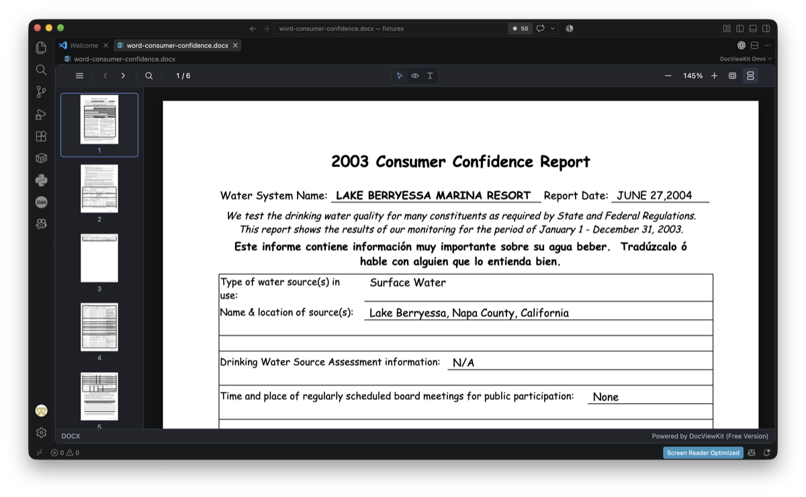
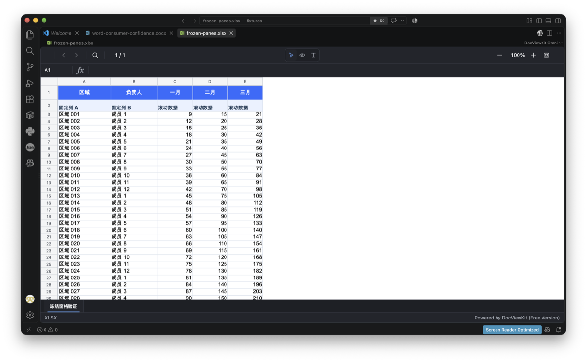
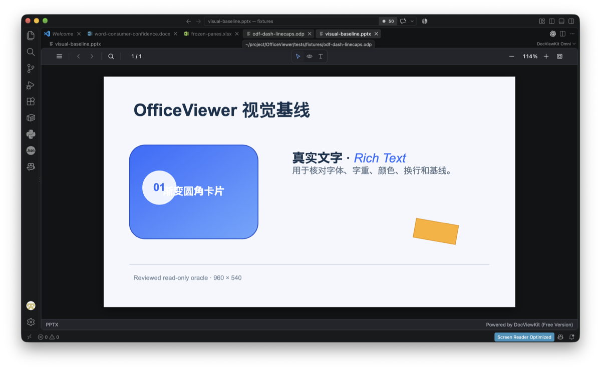
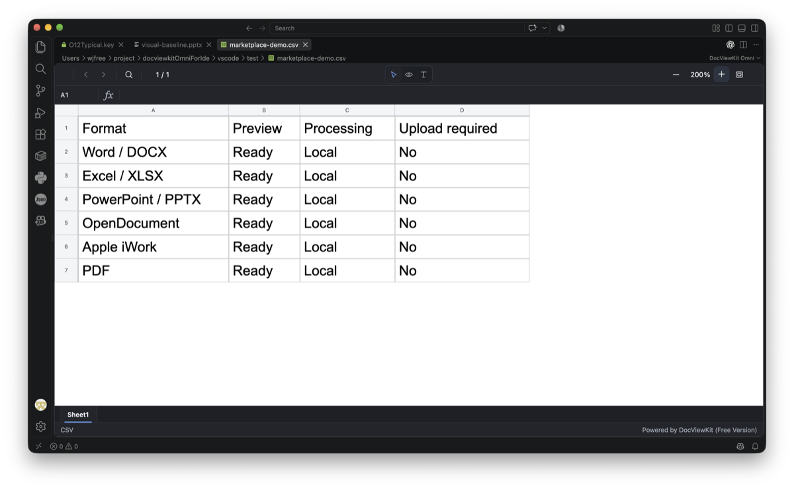

# DocViewKit Omni for VS Code

Preview Office, PDF, OFD, OpenDocument, and iWork files without leaving VS Code. Documents stay on your device or IDE-managed remote workspace—no uploads and no conversion server.

DocViewKit Omni is a read-only document previewer for developers and technical teams. Read specifications, spreadsheets, presentations, reports, and reference documents alongside your code. The bundled DocViewKit Viewer parses and renders supported documents inside the IDE; no Office installation, document upload, account sign-in, or conversion server is required to preview files. Every available format is included for free.

| Word document | Excel workbook |
| --- | --- |
|  |  |
| PowerPoint presentation | CSV data |
|  |  |

## What you can preview

| Document family | File extensions |
| --- | --- |
| Word and rich text | `docx`, `docm`, `dotx`, `dotm`, `doc`, `rtf` |
| Excel and tabular data | `xlsx`, `xlsm`, `xltx`, `xltm`, `xls`, `csv` |
| PowerPoint | `pptx`, `pptm`, `ppsx`, `ppsm`, `potx`, `potm`, `ppt` |
| OpenDocument text | `odt`, `ott`, `fodt` |
| OpenDocument spreadsheets | `ods`, `ots`, `fods` |
| OpenDocument presentations | `odp`, `otp`, `fodp` |
| Apple iWork | `pages`, `numbers`, `key` |
| WPS Office | `wps`, `et`, `dps` |
| Fixed-layout documents | `pdf`, `ofd`, `xps`, `oxps` |

Rendering depth varies by format and document.

## Reading tools

- **Navigation:** browse document pages, presentation slides, and workbook sheets; use thumbnails where the format supports them.
- **Zoom:** inspect small text, tables, diagrams, and other document details at a comfortable scale.
- **Search:** find document text and navigate to matching content where supported.
- **Text selection:** select and copy readable text where supported by the format and interaction mode.
- **Interaction modes and external links:** switch between available reading interactions; validated external links open through the IDE's normal handler.
- **IDE integration:** previews follow IDE theme changes and use the IDE language where a matching Viewer translation is available. Files refresh when the host reports a change, and preview resources are released when the editor closes.

## Privacy and workspaces

Parsing, rendering, and search run inside the IDE's preview environment. The plugin does not upload document contents or send file names and paths to a remote service. Runtime scripts, fonts, Wasm, and format components are bundled with the extension; format components load on demand without downloading remote executable code.

Files are read through the IDE's filesystem and permission APIs. In an IDE-managed remote workspace, file access follows that host's connection and permissions. Document bytes are passed to the preview environment, so a remote workspace does not imply that all processing stays on the remote machine. Opening an external link uses the IDE's usual external application or browser and can contact that destination.

## Compatibility and limits

DocViewKit Omni is read-only. Document editing, annotations, and format conversion are outside its scope. Macros and active document content are not executed. Print and fullscreen controls are disabled in the IDE integration.

Layout, fonts, complex objects, and embedded resources depend on the format and bundled Viewer version. Complex or older documents, including some legacy iWork variants, may be incomplete or unsupported. Isolated object or resource failures are handled on a best-effort basis so usable content can remain visible. Preview support does not guarantee that every feature of the original authoring application is reproduced.

### OFD preview

Preview OFD 1.0 and 1.1 fixed-layout documents (`.ofd`) locally in a read-only editor, without uploading them or using a conversion server. Open an OFD file normally to view its document content and page layout. Rendering covers the supported subset of OFD; the plugin does not provide trusted digital-signature validation.

## Installation and requirements

Requires desktop VS Code **1.125.0 or newer** with Webview support. Install **DocViewKit Omni** (`docviewkit.docviewkit-omni`) from [Visual Studio Marketplace](https://marketplace.visualstudio.com/items?itemName=docviewkit.docviewkit-omni) or [Open VSX](https://open-vsx.org/extension/docviewkit/docviewkit-omni). Both markets receive the same versioned VSIX.

For offline installation, download the `.vsix` and `.vsix.sha256` files from the matching [GitHub Release](https://github.com/docviewkit/docviewkit-omni-ide/releases), verify SHA-256, and choose **Extensions → Install from VSIX…**. After installation, supported local files can be previewed without a network connection. Installation and extension updates use your IDE's configured distribution service.

Open a supported file from the IDE. If another editor is selected, use **Open With… → DocViewKit Omni**. Cursor, Windsurf, VSCodium, and other VS Code-compatible editors must provide the required extension API and Webview behavior; availability in their market does not certify host compatibility.

## Troubleshooting

If the preview does not open, confirm the file extension and required IDE version, then select DocViewKit Omni explicitly with **Open With…**. For a rendering problem, open **View → Output → DocViewKit Omni** and copy the diagnostic details. Include the plugin version, IDE version, file format, and steps to reproduce in an [issue](https://github.com/docviewkit/docviewkit-omni-ide/issues). Remove private paths or document content before sharing; attach a document only if you have permission.

The bundled DocViewKit Viewer includes every available format and is licensed under Apache-2.0. Third-party components retain their included notices. DocViewKit Omni is powered by [DocViewKit Viewer](https://docviewkit.com/).

[Privacy Policy](https://docviewkit.com/privacy/docviewkit-omni/) · [End User License Agreement](https://docviewkit.com/license/docviewkit-omni/) · [Report an issue](https://github.com/docviewkit/docviewkit-omni-ide/issues)
